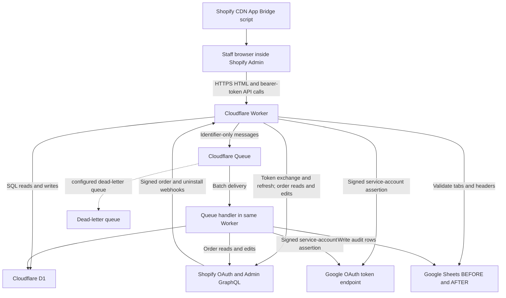

# Application context for architecture and security review

Prepared: 2026-10-26. Audience: GPT Astra with access to the source repository.

This document describes the local implementation and configuration inspected on that date. It is a review handoff, not a penetration-test report or a statement that the deployment is secure. Source references use file names and function names so they remain useful as line numbers change. Recheck them against the exact revision under review.

## 1. Owner-confirmed scope and evidence boundary

- Application URL: `https://auto-line-item-zero-france.phoxnixwaterfilter.workers.dev/`.
- Use: the owner's own France Shopify store. The code supports multiple shops, but multiple independent customers are not the stated operating model.
- Primary concern: reading and writing Shopify order data, including every system that receives it.
- Deliverable requested: application documentation and a prompt for GPT Astra to review the Git repository for potential vulnerabilities.
- A staging environment has not been established by this review. The owner does not know whether one exists.
- The owner previously authorized a small number of read-only live checks, then narrowed this task to documentation. No live application requests were made during this work. This document does not authorize future active testing.
- The local directory was not a Git repository when inspected. Its correspondence to the Git repository the owner will provide, and to the deployed Worker revision, must be verified separately.

Production secrets, Cloudflare account settings, actual Shopify app releases, spreadsheet sharing, logs, installed-store permissions, order counts, and live database contents were not inspected. Configuration in a local file is evidence of intended configuration, not proof of deployed settings.

## 2. What the application does

The app is named **Auto Remove Line Item For France** in `shopify.app.toml`. It runs inside Shopify Admin. It finds orders containing configured target variants and sets positive target quantities to zero using Shopify's order-edit API.

There are two triggers:

1. **Manual:** staff choose an inclusive date range, preview eligible orders, select orders, and confirm execution.
2. **Automatic:** staff enable automatic processing for a shop; signed `orders/create` webhooks create work for orders created strictly after the enable time.

Each destructive flow first writes a BEFORE audit to Google Sheets. After Shopify commits, the app saves a result in D1 and writes an AFTER audit. Retrying an order with a persisted result performs audit reconciliation instead of a new edit. These are implementation steps; their behavior under crashes, concurrency, and upstream ambiguity needs independent review.

Current configured target variant IDs in `wrangler.jsonc` are `67655138050101` and `67655020937269`. Older README/specification/test examples use `58780018377088` and `58414723465600`. Treat the deployment's actual `TARGET_VARIANT_IDS` value as authoritative for runtime behavior. Confirm that it names the intended France-store variants.

The edit sets `quantity: 0`, `restock: false`, and commits with `notifyCustomer: false` and a configurable staff note. It changes order line quantities and totals through Shopify. This implementation does not directly call a payment gateway, issue an explicit refund mutation, or restock inventory. Financial effects outside those explicit operations must be checked against actual Shopify behavior and store configuration.

## 3. Architecture



The HTTP handler and queue consumer share source modules and environment bindings. They are separate invocations, not one transaction or persistent process. D1 is durable state. Queue messages request work; they do not contain the order snapshot or credentials. Google Sheets is a separate durable copy of order data.

No scheduled handler or cron trigger is present in the inspected entry point/configuration. Automatic processing depends on webhook delivery and queues, not periodic order scanning.

### Component/source map

| Source | Responsibility |
| --- | --- |
| `src/index.ts` | HTTP routing, response security headers, queue dispatch, ack/retry decisions |
| `src/auth.ts` | Shop validation, OAuth, App Bridge ID-token verification, staff authorization, installation persistence, offline token refresh, uninstall handling |
| `src/crypto.ts` | HMAC, signed cookies, base64 conversion, AES-GCM encryption/decryption |
| `src/api.ts` | Session, jobs, selection, progress, errors, cancellation, retry, automation APIs |
| `src/automation.ts` | Signed order webhook ingestion, enable-time filter, automatic-job creation and enqueue |
| `src/processor.ts` | Discovery, work claims, snapshots, audit reservations, execution, reconciliation, progress |
| `src/safety.ts` | Sequential BEFORE -> mutation -> persist result -> AFTER helper |
| `src/shopify.ts` | GraphQL transport, pagination, target matching, begin/set/commit edit operations |
| `src/sheets.ts` | Google service-account token, audit-sheet validation, fixed-row writes |
| `src/core.ts` | Dates/time zones, target-ID parsing, retry delay, error classes, ETA |
| `src/types.ts` | Environment, queue payload, database-row and order/snapshot shapes |
| `src/ui.ts`, `src/ui-client.ts`, `src/ui-styles.ts` | HTML, inline client JavaScript, UI state/polling, styles |
| `src/dev.ts`, `dev/agentation.jsx`, `scripts/build-agentation.mjs` | Local annotation toolbar and development entry point |
| `migrations/0001_initial.sql` through `0005_automation_reconciliation.sql` | Database schema evolution |
| `wrangler.jsonc`, `shopify.app.toml`, `package.json`, `package-lock.json` | Deployment/bindings, Shopify settings, tooling/dependency declarations |

## 4. Hosting and configuration

### Cloudflare configuration observed locally

| Item | Configured behavior |
| --- | --- |
| Worker name | `auto-line-item-zero-france` |
| Production entry | `src/index.ts` |
| Development entry | `wrangler dev src/dev.ts` via `npm run dev` |
| Compatibility date | `2026-08-31` |
| Primary D1 binding | `DB`, database name `auto-line-item-zero-france` |
| Additional D1 binding | `auto_line_item_zero`, same database ID, `remote: true`; not declared in `Env` or used in reviewed application modules |
| Queue producer binding | `JOBS` |
| Queue name | `auto-line-item-zero-france` |
| Consumer settings | Maximum batch size 5, batch timeout 2 seconds, configured maximum retries 5 |
| Dead-letter queue | `auto-line-item-zero-france-dlq` |
| HTTP origin | `SHOPIFY_APP_URL` matches the owner-confirmed France Worker origin |

There is no explicit staging environment block in the inspected Wrangler configuration. Account-level controls cannot be inferred from that absence. The migration npm scripts refer to database name `auto-line-item-zero`, while the bindings name `auto-line-item-zero-france`; resolve this difference before using those commands.

### Environment variables and secrets

Values of secrets are deliberately omitted here. Do not copy `.dev.vars*`, private keys, raw tokens, or real customer records into a review conversation.

| Name | Purpose | Sensitivity and observed handling |
| --- | --- | --- |
| `SHOPIFY_API_KEY` | App/client identifier; exposed to App Bridge | Public identifier, present in local config |
| `SHOPIFY_API_SECRET` | OAuth client secret and HMAC key for ID tokens/webhooks/cookies | Secret; actual production storage not inspected |
| `SHOPIFY_APP_URL` | Origin/callback construction and mutating-request Origin comparison | Configuration |
| `SHOPIFY_API_VERSION` | GraphQL path version, configured `2026-07` | Configuration |
| `SHOPIFY_SCOPES` | `read_orders,read_products,write_order_edits` | Access policy configuration |
| `TOKEN_ENCRYPTION_KEY` | AES-256-GCM key for stored Shopify tokens | Secret; a literal value is present under `vars` in the inspected `wrangler.jsonc`; value not reproduced |
| `GOOGLE_SERVICE_ACCOUNT_EMAIL` | Service-account assertion issuer | Account identifier |
| `GOOGLE_PRIVATE_KEY` | Signs Google OAuth assertions | Secret; actual production storage not inspected |
| `GOOGLE_SPREADSHEET_ID` | Destination audit spreadsheet | Sensitive resource identifier; one globally configured spreadsheet |
| `TARGET_VARIANT_IDS` | Comma-separated numeric variant targets | Destructive-operation configuration |
| `MAX_DATE_RANGE_DAYS` | Inclusive date-span limit, configured `60` | Workload/business-rule configuration |
| `ORDER_EDIT_STAFF_NOTE` | Note passed to edit commit | Configuration |

Local `.dev.vars` and `.dev.vars.v2` filenames were observed without reading their values. `.gitignore` excludes `.dev.vars` but does not explicitly exclude `.dev.vars.v2` or a `.dev.vars.*` wildcard. Whether any such file is present in Git history is unknown.

## 5. HTTP surface and access rules

Paths below are relative to the configured origin. This table describes actual routing in `src/index.ts` and `src/api.ts`, not a proposed API.

| Method/path | Access and inputs | Behavior/side effects |
| --- | --- | --- |
| `GET /` | Public | 404 |
| `GET /app` | `shop` must be a valid shop domain; `host` parameter must exist; `Sec-Fetch-Dest` must not equal `document` | Returns generic embedded HTML when predicate passes; otherwise 404. Predicate does not establish API identity |
| `GET /auth` | Public; valid `shop` query parameter | Reads installation, sets signed OAuth-state cookie, redirects to Shopify |
| `GET /auth/callback` | OAuth state/cookie, fresh timestamp, valid query HMAC | Exchanges code; stores encrypted offline tokens or sets legacy staff cookie; redirects |
| `POST /webhooks/orders-create` | Raw-body HMAC, valid shop header, exact `orders/create` topic, valid order ID/date body | May persist automatic job/order and enqueue; valid ignored event returns 204; enqueue failure returns 503 |
| `POST /app/webhooks/orders-create` | Same handler | Compatibility alias for order webhook |
| `POST /webhooks/app-uninstalled` | Raw-body HMAC and syntactically valid shop header | Deletes matching shop; database foreign keys cascade jobs/orders; returns 204 |
| `GET /api/session` | Verified bearer ID token plus online staff exchange | Returns shop, staff identity, time zone, scopes, targets |
| `POST /api/jobs` | Bearer token, online staff exchange, same Origin; JSON `startDate`, `endDate` | Inserts discovery job, queues DISCOVER; success 202; queue failure 503 |
| `GET /api/jobs/:jobId` | Bearer token, authenticated shop owns job | Progress, counts, status, ETA and job error |
| `GET /api/jobs/:jobId/orders` | Bearer token, ownership; job PENDING and selection-ready | Returns eligible pending order preview; unavailable state 409 |
| `POST /api/jobs/:jobId/process` | Bearer token, online staff exchange, Origin, ownership; JSON `orderIds` | Validates Sheets, deletes unselected pending candidates, changes job state and queues selected work; success 202 |
| `GET /api/jobs/:jobId/errors` | Bearer token and ownership | Latest 100 failed or AFTER-audit-failed order errors |
| `POST /api/jobs/:jobId/retry-failed` | Bearer token, online staff exchange, Origin, ownership | Requeues FAILED/AUDIT_AFTER_FAILED rows; changes job to PROCESSING if any |
| `POST /api/jobs/:jobId/cancel` | Bearer token, online staff exchange, Origin, ownership | Requests cancellation, cancels PENDING/FAILED orders, recomputes progress |
| `GET /api/automation` | Bearer token | Shop enable timestamp and latest 20 automatic jobs |
| `PUT /api/automation` | Bearer token, online staff exchange, Origin; boolean `enabled` | Enabling validates Sheets and saves cutoff; disabling clears cutoff |

All `/api/*` paths attempt authentication before route dispatch. Missing/invalid identity yields 401. Known-job routes validate `job_` followed by 36 hex/hyphen characters; invalid format yields 400. Unknown or unowned resources generally return 404. Method handling is route-specific: do not assume every unsupported method consistently returns 405.

Mutating API requests require an `Origin` equal to `new URL(SHOPIFY_APP_URL).origin`. A missing Origin is rejected. Authentication and any online token exchange occur before the Origin check. Origin is an additional browser control, not the credential for a caller.

JSON validation is handwritten. There is no shared JSON schema, explicit application-level request-body size limit, or application-level rate-limit binding in reviewed source. Edge/provider limits and account-level WAF rules remain unknown. Examine valid JSON primitives/null as well as malformed JSON when reviewing the handlers.

### Response data shapes

- Session: `{ shop, staff: { id, email, name }, timezone, scopes, targetVariants }`.
- Job creation: `{ jobId, status: "PENDING" }`.
- Progress: `{ jobId, status, totalOrders, eligibleOrders, selectionReady, processedOrders, successCount, skippedCount, failedCount, remaining, progressPercent, etaSeconds, startedAt, completedAt, lastOrder, errorMessage }`.
- Preview: `{ orders: [{ id, orderName, createdAt, total, lines: [{ variantId, productTitle, variantTitle, sku, quantityBefore, unitPrice, lineItemId }] }] }`. The actual lines come from stored snapshot lines; they include more fields than the locally declared projection type suggests. Customer email is not included in this preview response.
- Errors: `{ errors: [{ jobOrderId, orderName, status, attempts, message }] }`.
- Automation: `{ enabled, enabledAt, jobs }`, with job ID/status/last-order/counts/created timestamp.
- API errors generally use `{ error }`. Unexpected outer request failures return generic 500 JSON.

## 6. Authentication and authorization internals

### Embedded API identity

The browser obtains a fresh `window.shopify.idToken()` for each call and sends `Authorization: Bearer <token>`. The app does not store these bearer tokens in localStorage.

`verifyIdToken` checks token segmentation, an HS256 header, HMAC with `SHOPIFY_API_SECRET`, audience equal to `SHOPIFY_API_KEY`, truthy subject/expiry/not-before, unexpired expiry, not-before not in the future, matching issuer/destination hostnames, and a destination hostname matching the shop-domain regex. Current code compares URL hostnames; it does not explicitly compare full issuer/destination URL structure or enforce runtime types for every claim. Review exact semantics in `src/auth.ts` rather than assuming a third-party JWT library enforces additional checks.

Shop domains are lowercased and validated against `^[a-z0-9][a-z0-9-]*\.myshopify\.com$`, with maximum length 255. The verified token's destination supplies the shop identity for API queries; a browser `shop` query parameter is not API authorization.

For non-GET requests, `/api/session`, or a missing installation, `authenticatedStaff` exchanges the ID token with Shopify for an online access token and requires an associated user and configured scopes in `associated_user_scope`. Other GET requests for an installed shop use the verified ID token without a new online permission exchange. `missingScopes` trims scopes and accepts a write scope as satisfying the corresponding read scope.

If no installation exists, a verified embedded request can exchange for an expiring offline token and save the installation. API authentication can therefore have installation-related writes/upstream calls even on a GET when installation state is absent.

### OAuth installation and legacy staff login

`beginAuth` determines install/staff mode by whether an active installation exists. It creates a random UUID nonce and a signed payload containing shop, nonce, mode, and ten-minute expiry. Cookie attributes are `Path=/; HttpOnly; Secure; SameSite=Lax`. Staff mode requests per-user authorization.

The callback verifies shop/code/state-cookie/nonce, a timestamp within five minutes, and a query HMAC. It exchanges the authorization code server-side. Install mode requests expiring offline tokens. Tokens are encrypted before installation persistence. A post-install step fetches shop time zone and registers an uninstall webhook; failure is logged and installation saving is not rolled back.

Staff-mode OAuth creates a signed `app_session` cookie containing user fields and an encrypted online token, capped at twelve hours. Current API authentication accepts only bearer ID tokens and rejects cookie-only sessions. Do not confuse this retained cookie path with the active API identity mechanism.

### Offline credential encryption and rotation

`src/crypto.ts` uses Web Crypto AES-GCM with a key that must decode to 32 bytes and a fresh random 12-byte IV per encryption. Ciphertext and IV are base64url strings in D1. The same environment key serves installations; no key-version column or automated key-rotation migration is present.

`accessToken` returns decrypted tokens when expiry is absent or more than five minutes away. Otherwise it claims a D1 refresh lock conditional on ciphertext and a stale-lock window of two minutes, decrypts the refresh token, refreshes at Shopify, encrypts replacement credentials, and clears the lock. When another invocation owns the lock, it raises a retryable error. Review crash windows across Shopify refresh and D1 persistence separately.

Online tokens obtained for API authorization are used to check staff identity/scopes; queue edits subsequently use the installation's offline token. Job rows do not contain the initiating staff user ID. Review whether queued work should continue after the initiating user's permissions change, based on the owner's intended policy.

## 7. Order workflows in detail

### Manual discovery and selection

1. Staff select dates and click Preview. Browser posts `{ startDate, endDate }`.
2. Backend validates ISO calendar dates, ordering, and inclusive span against `MAX_DATE_RANGE_DAYS`.
3. D1 job is inserted PENDING and a DISCOVER message is sent. A failed initial send marks the job FAILED.
4. Consumer loads job joined to installation, obtains offline credentials and moves to DISCOVERING.
5. Shop-local date boundaries are converted to UTC for a Shopify `created_at` search. Orders paginate 50 references at a time.
6. Every referenced order is fetched with its lines. Line pagination uses 250 lines per page. Cancelled orders and orders with no positive current target quantity are excluded.
7. Eligible order snapshots are inserted into `job_orders` using INSERT OR IGNORE. No Sheets write or order-edit mutation is made during preview; order data, including email, is already copied into D1.
8. Cursor and counts are persisted. Another discovery page is queued, or job returns to PENDING with `selection_ready=1`.
9. Staff retrieve preview, select one or more `jo_...` identifiers and confirm in the browser. Server accepts at most 10,000 submitted IDs, deduplicates, validates format and checks membership in that job's eligible pending candidates.
10. Backend validates audit-sheet setup. A D1 batch deletes unselected pending rows and updates selected counts/job state. Queue sends occur afterward in batches of 100.

Selection checks happen before the D1 batch. The job UPDATE does not condition its WHERE clause on its previously read PENDING/selection-ready state. D1 and queue sends are separate operations. These details matter when evaluating concurrent submissions and partial enqueue failure.

### Automatic order ingestion

1. Staff change checkbox then click Apply; checkbox alone does not persist the setting.
2. Enabling first validates Sheets and stores `automation_enabled_at` if absent. Reapplying enabled preserves the existing cutoff. Disabling sets it NULL. Re-enabling after disable creates a new cutoff.
3. Shopify posts raw order JSON. The handler verifies raw-body HMAC before JSON parsing, validates the shop header and exact topic, then validates GraphQL order ID/date fields.
4. Only an active installed shop with an enable timestamp and order creation strictly later than that timestamp creates work.
5. A D1 batch inserts an automatic job and order if absent. A unique index on `(shop_id, automatic_order_id)` deduplicates the automatic job.
6. If the persisted order is PENDING, a PROCESS message is sent. Enqueue failure yields 503 so the same event can retry. Duplicate messages can exist; consumer claims must handle them.
7. Consumer uses the same order processor as manual execution. Waiting work from a disabled/different automation period is skipped unless it is already PROCESSING, has a written BEFORE audit, or has persisted results.

### Shared destructive processor

1. Load the job-order by both IDs, its job with matching shop, and an ACTIVE installation. Ignore missing context or SUCCESS/SKIPPED/CANCELLED orders.
2. Apply automation-period/cancellation logic.
3. Claim the job-order with a conditional UPDATE: PENDING/FAILED/AUDIT_AFTER_FAILED or PROCESSING with `updated_at` older than ten minutes. Claim increments attempts and marks PROCESSING.
4. Reload context. If `result_json` exists, reconcile AFTER only and finish SUCCESS.
5. Otherwise read the latest order from Shopify using the offline installation token. Skip cancelled orders.
6. If no target has positive current quantity, skip; however, when BEFORE was written and a snapshot exists, persist a reconciled result using an existing edit ID or literal `reconciled`, write AFTER, and finish SUCCESS.
7. If targets remain positive, construct a fresh snapshot. Reserve BEFORE rows if none were reserved, saving snapshot and row count at that time.
8. Write BEFORE to its fixed row range; mark BEFORE WRITTEN in D1.
9. `orderEditBegin` creates a calculated order/session. Paginate calculated lines. Set each matching positive calculated line quantity to zero with `restock: false`.
10. `orderEditCommit` commits without customer notification, using configured staff note. Return edit-session/calculated ID and resulting total.
11. Save result JSON/edit ID in D1, with AFTER PENDING.
12. Reserve AFTER rows if needed; write AFTER using stored snapshot; mark AFTER WRITTEN; mark order SUCCESS and recompute job counters.

```text
BEFORE Sheets write
  -> D1 BEFORE status
  -> Shopify begin/set/commit
  -> D1 result persistence
  -> AFTER Sheets write
  -> D1 order completion/counters
```

There is no distributed transaction covering these arrows. A timeout does not prove the upstream mutation failed. Local `result_json` prevents another mutation only when it was successfully persisted and observed. When the latest snapshot differs from a previous reservation, note that `writeBefore` receives the fresh snapshot while `writeAfter` reads the snapshot stored at reservation time.

### Retry, cancellation and progress

- A persisted result leads to AFTER reconciliation, including manual retry of AUDIT_AFTER_FAILED.
- Retry API selects FAILED/AUDIT_AFTER_FAILED rows, marks job PROCESSING and sends messages. It does not provide a transactional outbox.
- Cancellation marks an active job CANCELLING and PENDING/FAILED orders CANCELLED. The processor's branch permits already-PROCESSING work to proceed; cancellation is not rollback.
- Progress is recalculated from per-order rows. Job COMPLETED can still have a nonzero failed count; status alone is not an all-orders-success guarantee.
- Browser polls active progress approximately every two seconds, retries polling after errors in five seconds, and polls automation every ten seconds.

## 8. Data transfers and storage

| Transfer | Data sent | Destination/persistence |
| --- | --- | --- |
| Browser -> Worker API | Bearer ID token, date range, selection IDs, boolean automation setting, job path IDs | Request memory; job/setting data written to D1 |
| Worker -> browser | Generic HTML, public client ID, staff/session details, order previews, progress/errors | Browser memory/DOM; current job ID and theme in localStorage |
| Worker -> Shopify OAuth | Client ID/secret plus code, ID token or refresh token | Shopify HTTPS token endpoint; offline token response encrypted into D1 |
| Worker -> Shopify GraphQL | Installation access token header, order/time-range IDs, edit variables and staff note | Shopify order reads and durable order edits |
| Shopify -> Worker webhook | Order payload or uninstall payload, HMAC and identifying headers | Raw body in memory; selected order ID/name/date used to create D1 state |
| Worker -> queue | `{ kind: "DISCOVER", jobId }` or `{ kind: "PROCESS", jobId, jobOrderId }` | Cloudflare queue delivery/retry storage |
| Worker/consumer -> D1 | Encrypted installation tokens, shop metadata, jobs, full target-line snapshots, result/error/audit states | D1 tables |
| Worker/consumer -> Google OAuth | RS256-signed service-account assertion with spreadsheets scope | Google OAuth endpoint; returned access token cached in module memory |
| Consumer -> Google Sheets | BEFORE/AFTER rows described below, bearer Google token | One configured spreadsheet; fixed rows overwritten on retry |
| Worker/consumer -> logs | Operation/status/error messages; some shop/message identifiers | Cloudflare logging infrastructure if enabled; settings/retention unverified |

External calls use HTTPS URLs constructed in `auth.ts`, `shopify.ts` and `sheets.ts`. D1 and queues use Cloudflare bindings rather than app-supplied database/queue URLs. Provider-at-rest encryption, data residency, log redaction at the platform, and access permissions were not verified.

### D1 data model

| Table | Stored fields and relationships |
| --- | --- |
| `shops` | UUID ID, unique domain, access/refresh token ciphertext and IV, token expirations/refresh lock, scopes, time zone, ACTIVE/UNINSTALLED status, install/update times, automation enable time and `automation_checked_through` |
| `jobs` | UUID ID, shop foreign key, date range/time zone, status, discovery cursor, totals/counters/rolling average, last order name, timestamps, selection readiness, error message, automatic order ID and captured enable time |
| `job_orders` | UUID ID, job/shop foreign keys, Shopify order ID/name, eligibility/status/attempts, BEFORE/AFTER statuses and row ranges, snapshot JSON, result JSON, edit ID, error/timestamps |
| `audit_counters` | Global next row for BEFORE/AFTER; atomic UPDATE RETURNING reservations |

`snapshot_json` includes order ID/name/creation date, **customer email**, original total, and target lines containing variant/product/variant-title/SKU/current-quantity/unit-price/line-item IDs. These snapshots are not encrypted by application code. `result_json` includes edit ID and total after.

Foreign keys delete jobs/orders when a shop is deleted. Job-order uniqueness is `(shop_id, job_id, shopify_order_id)`, allowing the same Shopify order in different manual jobs and in an automatic job. Claim ownership is per job-order row. Audit counters are global to the one spreadsheet, not per shop.

`automation_checked_through` is added by migration 0005; no active reconciliation scan using it was found in reviewed runtime source. Its presence does not establish scheduled recovery.

### Google Sheets audit fields

BEFORE columns, in order:

```text
Timestamp | Shop Domain | Job ID | Order ID | Order Name | Order Created At |
Customer Email | Variant ID | Product Title | Variant Title | SKU |
Quantity Before | Unit Price | Line Item ID | Order Total Before | Processing Status
```

AFTER columns, in order:

```text
Timestamp | Shop Domain | Job ID | Order ID | Order Name | Variant ID |
Product Title | Variant Title | SKU | Quantity After | Order Total After |
Shopify Order Edit ID | Processing Status | Error
```

Google service-account access uses the `https://www.googleapis.com/auth/spreadsheets` scope. The module caches tokens by service-account email and expiry. Sheet validation checks tab names and exact header rows, reads column A occupancy and raises counters to at least the next occupied row. Writes use `valueInputOption=RAW`, fixed ranges, and one row per target snapshot line.

Removing a shop from D1 does not delete its Google Sheets rows. No automatic age-based purge, data-export endpoint, customer-redaction route, spreadsheet cleanup, or backup deletion process was found in the reviewed runtime. Required business retention and privacy obligations must come from the owner; they are not established by this document.

## 9. Trust boundaries and controls to examine

| Boundary | Implemented behavior | What the reviewer must establish |
| --- | --- | --- |
| Public browser -> HTML | Shop syntax/host-presence/fetch-destination predicate | Generic UI visibility must not imply authenticated API access |
| Browser -> API | HMAC-verified App Bridge token, shop derived from token | Claim validation, staff permissions for read/write, tenant identity |
| Browser -> mutation | Online exchange/scopes plus Origin | Every mutation has correct authorization independent of UI confirmation |
| Worker -> D1 | Bound SQL values; ID ownership checks on public job routes | No route permits foreign-shop reads/writes; internal joins preserve identity |
| Shopify -> order webhook | HMAC over raw body; topic/domain headers separately validated | Replay, origin/tenant binding, unsigned-header handling and duplicate work |
| Shopify -> uninstall | HMAC over raw body; deletion uses shop header | Correct deletion identity, payload/topic binding and replay behavior |
| Queue -> processor | Payload shape check, database context loading, per-row work claim | Invalid identifiers, duplicate/stale deliveries, concurrent jobs and stale claims |
| Processor -> Shopify/Sheets | Sequential audit/mutation persistence and reconciliation | Every crash/timeout boundary, snapshot consistency and audit accuracy |
| Operator -> deployment/secrets | Wrangler vars/secrets conventions and config files | Actual secrets handling, account access, environment separation, release provenance |

Source behavior is described here to support independent analysis. These rows are not proof of an exploitable vulnerability or a complete list of defenses.

### Browser policies and rendering

Normal responses passing through the main header wrapper receive:

```text
Content-Security-Policy: default-src 'self'; script-src 'self' 'unsafe-inline' https://cdn.shopify.com; style-src 'self' 'unsafe-inline'; frame-ancestors https://admin.shopify.com https://*.myshopify.com
Referrer-Policy: no-referrer
X-Content-Type-Options: nosniff
Permissions-Policy: camera=(), microphone=(), geolocation=()
```

The outer exception handler returns generic JSON without re-entering that wrapper. API JSON and HTML helpers set `Cache-Control: no-store`; do not assume identical headers on all response paths. HSTS is not explicitly set in the reviewed application code; edge behavior remains unverified.

The UI loads App Bridge from Shopify CDN and embeds application scripts/styles inline. Dynamic order/product/error/staff strings in the inspected client are inserted with `textContent`/DOM APIs. Browser confirmation protects accidental clicks but is not server authorization. LocalStorage holds `currentJobId` and theme, shared by app origin, without a shop-specific key.

## 10. Reliability, retries and operational visibility

- Shopify HTTP 429/5xx and transport failures become `RetryableError`; other HTTP errors and GraphQL errors generally become `PermanentError`. A successful HTTP GraphQL response containing a throttle error is not classified by HTTP status alone.
- Google transport/429/5xx failures retry immediately up to three calls inside `googleFetch`, then become retryable. No delay is inserted between those inner retries. Non-success Google responses may contribute provider error messages to application errors.
- Queue handler processes batch messages sequentially within each invocation. Other invocations can run concurrently; configured batch size does not establish global serialization.
- Handler calls `message.retry` only for retryable errors when delivery attempts are below five. Delay uses exponential calculation with jitter and a cap of 3,600 seconds.
- At terminal handling the code generally acknowledges the message. Discovery failure can mark a job FAILED. A configured dead-letter queue does not prove every failed application operation reaches it, because acknowledged work is removed.
- `processOrder` sets FAILED or AUDIT_AFTER_FAILED on terminal errors; intermediate retryable failures return to PENDING. Exceptions that are not retryable are generally handled without rethrowing from that function.
- PROCESSING claims can be reclaimed after ten minutes, but a redelivery before that point can return without a claim and then be acknowledged. Review recovery after abrupt termination and the existence of any operator recovery process.
- There is no explicit fetch timeout/AbortController in reviewed external-call helpers.
- `safeError` truncates `Error.message`; it is not a structured secret/PII redaction mechanism. Logs and exposed error endpoints require separate inspection.
- No configured alert rules, reconciliation scheduler, backup policy, restore drill, metrics export, or CI workflow was available in inspected application source.

## 11. Review scenarios to derive from this architecture

These are questions for Astra to investigate with source evidence and isolated tests. They are not findings established by this document.

1. Can any unauthenticated or insufficiently authorized user read order previews/errors or start an edit? Compare GET permission checks with mutation checks and permission revocation.
2. Can shop/job/order identifiers from different shops be combined through any route or queue path? Although current usage is one store, the code's tenant boundaries still exist.
3. Does ID-token validation reject malformed claim types, wrong algorithm/signature/audience/issuer/destination, expired tokens and future not-before values?
4. Are OAuth callback canonicalization, nonce expiry/reuse, cookie handling and failed installation setup handled correctly?
5. Can a captured valid webhook be replayed to another route or with modified identifying headers? Verify body/topic/shop binding before destructive or deletion actions.
6. Does duplicate webhook delivery remain safe across retries, restarts, enqueue failures and automation disable/re-enable?
7. Can parallel selections for one job or overlapping manual/automatic jobs act on the same Shopify order concurrently?
8. What happens when a consumer dies before/after claim, BEFORE write, Shopify begin/set/commit, result persistence, AFTER write, and queue acknowledgment?
9. If Shopify commits but the response or D1 write fails, can retries establish what happened without false audit claims or duplicate business effects?
10. Do stored and freshly fetched snapshots stay consistent when quantities, prices, line count or targets change between retries?
11. Can a partial queue send leave PENDING orders stranded, and can cancellation/retry revive work unexpectedly?
12. What happens to a token refresh when Shopify rotates credentials but the Worker dies before D1 saves replacements?
13. Do API body validation, selection/date limits and query pagination prevent crashes or excessive Shopify/Google/Cloudflare usage?
14. Can audit rows be overwritten, mixed between installations or modified externally without detection? Who can read customer email copies?
15. Do secrets, log messages, browser responses, bundled dev assets or repository history expose credentials or customer data?
16. Are deployment bindings, targets, released webhook URLs/scopes and migrations consistent with the intended store and environment?

For any proposed regression test, specify setup, action, expected behavior, source reference, and how to observe Shopify mutations, D1 changes, queue events and Sheets writes. Use synthetic records and an isolated test environment for changes to orders or installation state.

## 12. Existing verification and its limits

The following commands were run locally during this documentation session before the owner clarified documentation-only scope:

| Command | Observed result | What it establishes |
| --- | --- | --- |
| `npm test` | 6 files / 52 tests passed | Existing local assertions passed with their mocks/fixtures |
| `npm run typecheck` | Passed | TypeScript compilation checks passed |
| `npm audit --json` | 0 reported advisories | Registry audit reported no known advisories for the inspected installed dependency tree at that time |

Tests include matching/date/ETA logic, safety-helper sequencing, HMAC/signed values/ID-token basics, route rejection, one foreign-job read case, staff-exchange errors, automation persistence/deduplication and disable behavior, and UI controls. Automation tests use in-memory SQLite with a D1 adapter and mocked authentication/Sheets. Some transport tests stub fetch. These tests do not establish production permission configuration, full mutation workflow correctness, crash recovery, concurrent isolation, or absence of vulnerabilities.

`npm run lint` is another `tsc --noEmit` invocation, not an independent security linter. No live tests, deployed configuration export, D1 reads, order reads/writes, spreadsheet access, Cloudflare changes, dependency upgrades, or application fixes were performed for this handoff.

## 13. Inputs Astra still needs

Ask for nonsecret evidence where necessary:

- Git repository and exact commit; deployed Worker version/date or release identifier, to link source to runtime.
- Actual installed store domain and whether installation is restricted to it; never request access-token values.
- Current deployment binding names and environment names, secret **names** only, and applied migration list.
- Confirmation of intended target variants and desired treatment of cancellation, already-edited orders, stock and financial side effects.
- Staff roles allowed to preview, execute, enable automation, cancel and retry; expected effect of later permission revocation.
- Typical/peak orders and staff concurrency; maximum expected manual batch size.
- Spreadsheet sharing/access list, retention rules, Cloudflare account roles, logging/backup/alert settings, with private values redacted.
- Whether an isolated development store and separate D1/queue/spreadsheet exist for validation. Do not assume `npm run dev` isolates all configured remote resources.

## 14. Keeping this document accurate

Runtime source and the exact deployed revision take precedence over older prose. Existing `docs/architecture.md` describes webhook processing as a future extension even though it is implemented. Existing API/security specifications omit some current routes/scopes. README and test example targets differ from local runtime configuration. Use these older documents for intent only after comparing them with code.

Update this handoff after changes to route/auth checks, order mutations, snapshot fields, migrations, secrets, bindings, webhooks, retries or retention. Refresh test counts/results rather than carrying this session's results forward as evidence for a new revision.

Useful primary references for the reviewer: [Cloudflare Worker secrets](https://developers.cloudflare.com/workers/configuration/secrets/), [Shopify webhook verification](https://shopify.dev/docs/apps/build/webhooks/verify-deliveries), and [OWASP authorization testing automation](https://cheatsheetseries.owasp.org/cheatsheets/Authorization_Testing_Automation_Cheat_Sheet.html). Verify current provider behavior against official documentation when reaching a provider-dependent conclusion.
